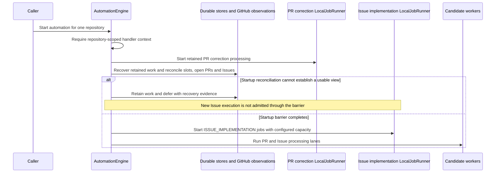
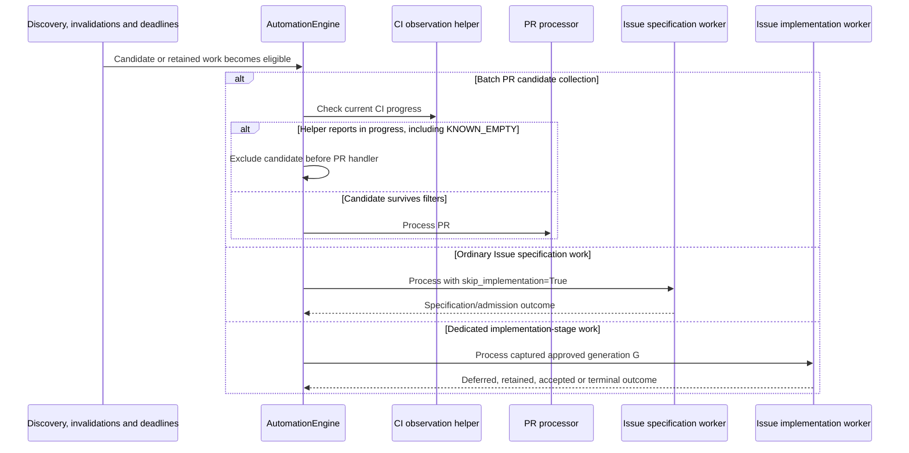
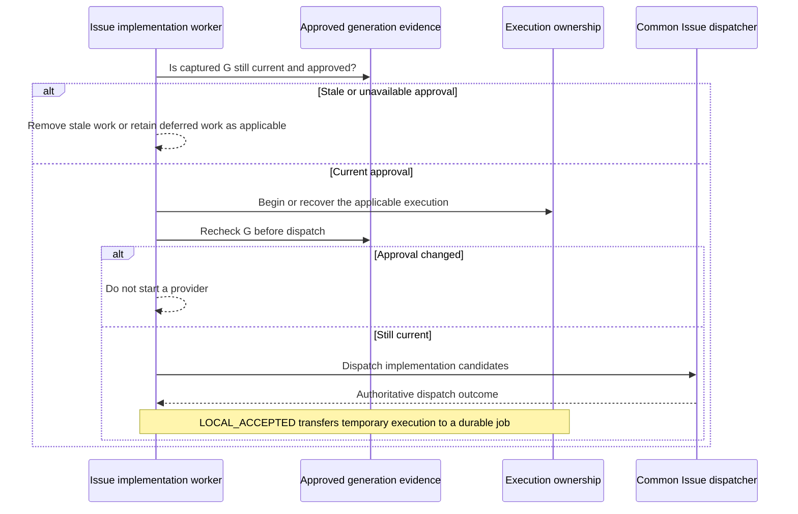

# Engine, startup and Issue lanes

Source snapshot: **`0769b84eaabcf2d0c6a80f6c62660bd179003e02`** (2026-10-18 UTC). [Scope and notation](README.md).

## E1. Startup is a reconciliation barrier, not just worker creation

PR review correction may be resumed before the Issue startup barrier. This is not permission to start new Issue work using an unreconciled slot view. Repository-scoped stores and the global capacity governor are different coordination scopes.

## E2. Candidate discovery can stop work before its handler

The producer loop also performs maintenance and periodic discovery. It should not be drawn as a single full-repository polling loop that alone owns all scheduling. Retained jobs, retry obligations and deadlines have their own reentry paths. See [CI reachability](pr-ci-and-repair.md).

## E3. The implementation lane does not perform semantic review

Normal dispatch is no longer an engine-level `jules_mode` decision tree. The implementation lane calls the coordinator described in [provider dispatch](issue-provider-dispatch.md). A one-shot CLI can wait for its accepted local job; daemon workers can return. Neither behavior permits the worker's `finally` block to retire execution already transferred to that job.

Sources: [AutomationEngine][engine] (`start_automation`, `_get_candidates`, `_process_single_candidate`, `_process_single_candidate_reserved`); [dedicated implementation worker][worker]; [Issue dispatcher integration][issue] (`_dispatch_issue_candidates`).

[engine]: https://github.com/kitamura-tetsuo/auto-coder/blob/0769b84eaabcf2d0c6a80f6c62660bd179003e02/src/auto_coder/automation_engine.py
[worker]: https://github.com/kitamura-tetsuo/auto-coder/blob/0769b84eaabcf2d0c6a80f6c62660bd179003e02/src/auto_coder/issue_implementation_worker.py
[issue]: https://github.com/kitamura-tetsuo/auto-coder/blob/0769b84eaabcf2d0c6a80f6c62660bd179003e02/src/auto_coder/issue_processor.py
