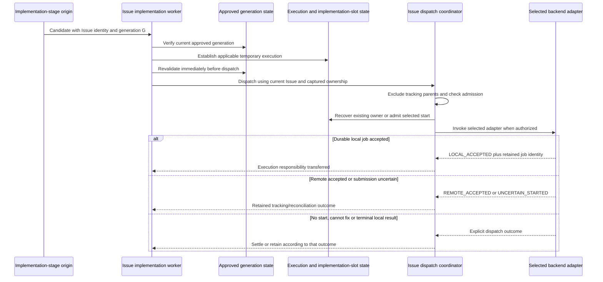
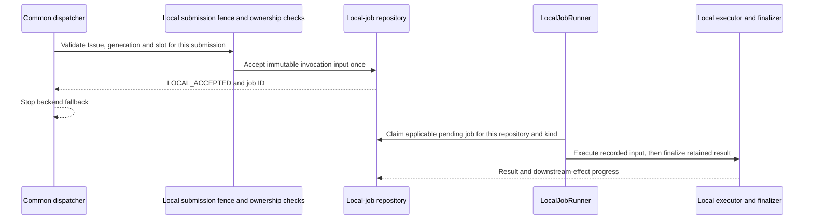

# Issue implementation admission and handoff

Source snapshot: **`0769b84eaabcf2d0c6a80f6c62660bd179003e02`** (2026-10-18 UTC). [Scope and notation](README.md).

## I1. Approval, execution ownership and dispatch are separate boundaries

An approved specification is not itself proof of a live provider task. A provider receipt is not proof that slot/tracking bookkeeping has completed. Local job acceptance is neither model completion nor PR creation.

## I2. The normal local route is a durable handoff

The source still contains `_apply_issue_actions_directly`; its existence does not make the synchronous path the normal daemon implementation route. The local adapter built for the common dispatcher accepts a job. Explicit processing can wait for that job without inventing a second invocation.

### Useful distinctions for refactoring

| Boundary | Evidence consumed | What it does not prove |
| --- | --- | --- |
| Specification approval | Current approved generation G | Provider started |
| Execution admission | Current execution and slot ownership | Provider accepted work |
| Local handoff | Durable job identity and immutable input | Model succeeded |
| Remote acceptance | Provider-specific receipt/retained claim | Local bookkeeping settled |
| Publication | Exact result ownership plus reconciled effects | PR merged or slot releasable |

See [ownership](issue-ownership-and-resumption.md), [local finalization](issue-local-execution.md) and [provider outcomes](issue-provider-dispatch.md).

Sources: [implementation worker][worker]; [Issue integration][issue] (`_dispatch_issue_candidates`, `_build_issue_dispatchers`, `_apply_issue_actions_directly`); [coordinator][dispatch]; [local adapter][local].

[worker]: https://github.com/kitamura-tetsuo/auto-coder/blob/0769b84eaabcf2d0c6a80f6c62660bd179003e02/src/auto_coder/issue_implementation_worker.py
[issue]: https://github.com/kitamura-tetsuo/auto-coder/blob/0769b84eaabcf2d0c6a80f6c62660bd179003e02/src/auto_coder/issue_processor.py
[dispatch]: https://github.com/kitamura-tetsuo/auto-coder/blob/0769b84eaabcf2d0c6a80f6c62660bd179003e02/src/auto_coder/issue_dispatch.py
[local]: https://github.com/kitamura-tetsuo/auto-coder/blob/0769b84eaabcf2d0c6a80f6c62660bd179003e02/src/auto_coder/issue_local_job.py
