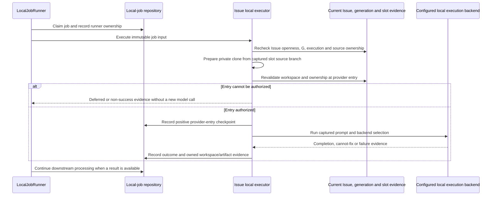
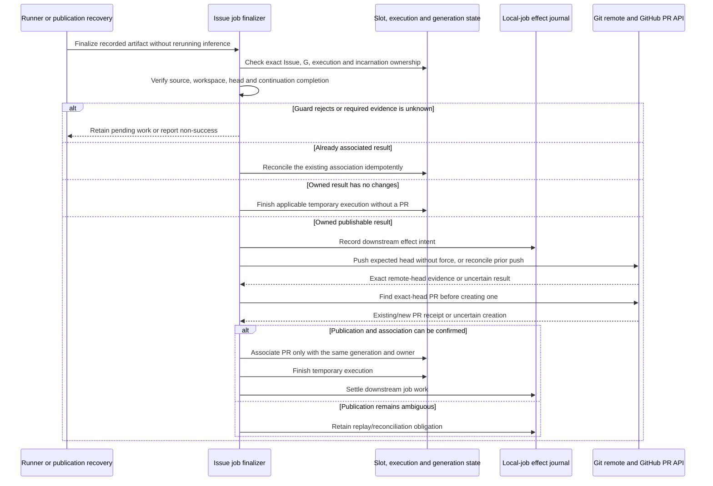

# Local Issue execution and PR publication

Source snapshot: **`e1da0e87eb7215d870cbaddd4737bcd9bd6a87e8`** (2026-10-15 JST). [Scope and notation](README.md).

## L1. Model execution records a result in an invocation-owned clone

The working repository lives below `job_workspaces` and uses a job/incarnation-specific branch. Its base is tied to the slot's source branch, not whichever HEAD happens to be checked out in the controller. The executor captures Git-visible result evidence. This path does not establish a universal requirement that every project test has passed.

The prompt asks the model not to publish to GitHub. That instruction and the private clone are not a claim of malicious-agent publication confinement.

## L2. Finalization, not model exit, owns publication completion

The sequence compresses separate effect checkpoints; it is not one transaction spanning Git, GitHub and local stores. An uncertain push is reconciled against the expected remote head. An uncertain PR creation is not a reason to blindly create another PR. Unknown continuation liveness/completion does not become successful exit by default.

The lifetime implementation slot can remain associated with the PR after this job settles. [Merge cleanup](pr-merge-and-recovery.md), not local model exit, eventually retires that ownership.

Sources: [runner][runner]; [job phases and entry evidence][jobs]; [Issue executor][local]; [publication finalizer][finalizer] (`local_publication_guard` consumption and publication classification).

[runner]: https://github.com/kitamura-tetsuo/auto-coder/blob/e1da0e87eb7215d870cbaddd4737bcd9bd6a87e8/src/auto_coder/local_job_runner.py
[jobs]: https://github.com/kitamura-tetsuo/auto-coder/blob/e1da0e87eb7215d870cbaddd4737bcd9bd6a87e8/src/auto_coder/local_job_handoff.py
[local]: https://github.com/kitamura-tetsuo/auto-coder/blob/e1da0e87eb7215d870cbaddd4737bcd9bd6a87e8/src/auto_coder/issue_local_job.py
[finalizer]: https://github.com/kitamura-tetsuo/auto-coder/blob/e1da0e87eb7215d870cbaddd4737bcd9bd6a87e8/src/auto_coder/issue_job_finalizer.py
