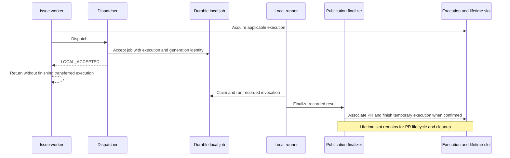

# Issue ownership and resumption

Source snapshot: **`e1da0e87eb7215d870cbaddd4737bcd9bd6a87e8`** (2026-10-15 JST). [Scope and notation](README.md).

## O1. Several lifetimes overlap

| Ownership/evidence | Produced or maintained by | Typical consumer | Not equivalent to |
| --- | --- | --- | --- |
| Approved implementation generation | Issue approval/admission path | Implementation worker and provider-entry checks | Task ID or PR head |
| Lifetime implementation slot | Slot admission/association/recovery | Dispatch, publication and retirement | One worker invocation |
| Temporary execution ownership | Implementation execution boundary | Worker, local executor and finalizer | Lifetime slot |
| Local job and incarnation | Local-job repository/runner | Executor and downstream replay | Provider completed successfully |
| Provider task binding | Provider-specific receipt/reconciliation | Continuation and retry routing | Source-Issue mention alone |
| Associated PR | Confirmed publication/association | Later PR processing and slot cleanup | Merge command accepted |

## O2. Worker return does not retire transferred ownership



## O3. Recovery resumes an obligation, not automatically the model

```mermaid
sequenceDiagram
    participant E as Restart or explicit processing
    participant J as Local-job repository
    participant R as LocalJobRunner
    participant F as Downstream finalizer
    E->>J: Load same-repository retained work and execution identity
    alt Runner liveness is unknown
        E-->>E: Hold ownership; do not assume the runner is dead
    else Prior runner is proven dead
        E->>J: Inspect provider-entry and result checkpoints
        alt Proven before provider entry
            E->>R: Recover eligible job for a first model entry
        else Provider entry occurred but outcome is incomplete
            E->>J: Retain/recover interruption evidence, not a fresh invocation
        else Recorded result has unfinished downstream work
            E->>F: Resume publication/association only
        end
    else Same owned execution is still active
        E-->>E: Wait or retain tracking without duplicate execution
    end
```

The engine's explicit-local path can wait for the accepted job. Its publication recovery scans completed artifacts with unfinished effects. Neither mechanism authorizes fresh inference simply because the original worker returned or the CLI was restarted.

Before reorganizing stores, identify the producer of each fact in [state and authority](state-and-authority.md). Matching an Issue number is insufficient when generation, attempt, incarnation or source ownership differs.

Sources: [engine recovery and explicit processing][engine] (`_run_explicit_local_issue`, `_resume_local_issue_publications`); [runner liveness and recovery][runner]; [job identity][jobs]; [association/finalization][finalizer].

[engine]: https://github.com/kitamura-tetsuo/auto-coder/blob/e1da0e87eb7215d870cbaddd4737bcd9bd6a87e8/src/auto_coder/automation_engine.py
[runner]: https://github.com/kitamura-tetsuo/auto-coder/blob/e1da0e87eb7215d870cbaddd4737bcd9bd6a87e8/src/auto_coder/local_job_runner.py
[jobs]: https://github.com/kitamura-tetsuo/auto-coder/blob/e1da0e87eb7215d870cbaddd4737bcd9bd6a87e8/src/auto_coder/local_job_handoff.py
[finalizer]: https://github.com/kitamura-tetsuo/auto-coder/blob/e1da0e87eb7215d870cbaddd4737bcd9bd6a87e8/src/auto_coder/issue_job_finalizer.py
