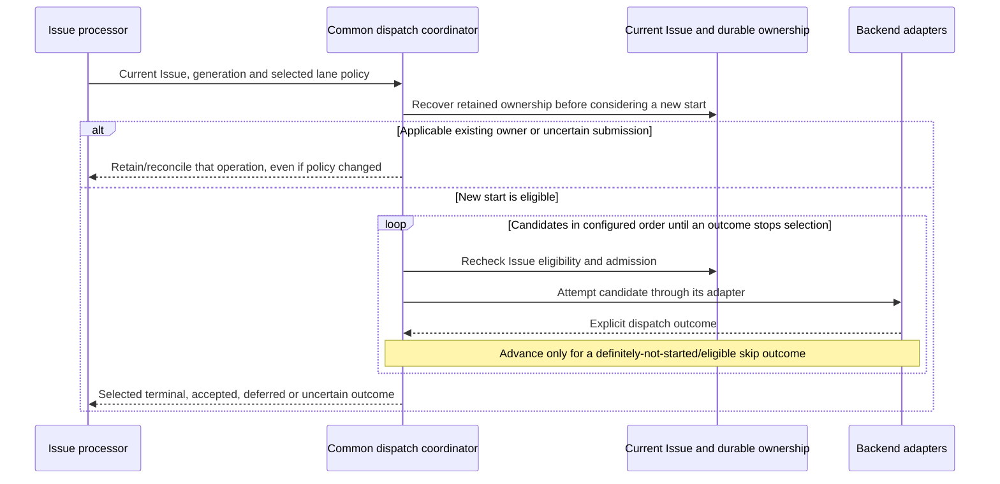
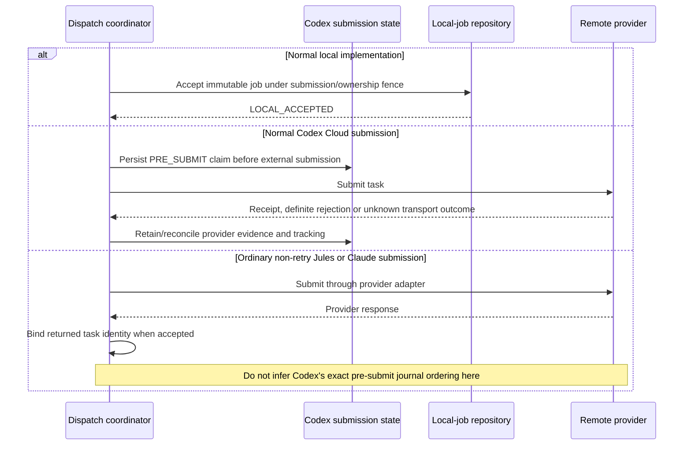

# Issue provider selection and acceptance

Source snapshot: **`e1da0e87eb7215d870cbaddd4737bcd9bd6a87e8`** (2026-10-15 JST). [Scope and notation](README.md).

## P1. Policy order is separate from ownership recovery

The coordinator consumes `backends.default`, `backends.normal_issue` and `backends.difficult_issue`. An absent lane can use the default; an explicitly empty lane stays empty. Configured order is not silently rearranged by quota or affinity. The local candidate allowlist and provider adapters are not interchangeable configuration surfaces.

| Outcome / condition | Meaning for selection |
| --- | --- |
| `SKIPPED_NOT_ELIGIBLE`, `FAILED_NOT_STARTED` | May permit the next candidate when the coordinator's admission rules allow it |
| Temporary pre-submission deferral | Stop this pass; do not reinterpret temporary unavailability as universal fallback authority |
| `LOCAL_ACCEPTED` | A durable local job owns continuation; stop |
| `REMOTE_ACCEPTED` | Retain provider tracking/bookkeeping; stop |
| `UNCERTAIN_STARTED` | Reconcile the same submission; stop |
| `LOCAL_COMPLETED`, `CANNOT_FIX` | A completed/entered attempt is not permission to try another model as though nothing started |

## P2. Provider adapters do not all have identical persistence boundaries

Retry-submission journaling is a separate path described in [retry and recovery](issue-retry-and-recovery.md). Jules speculation also uses a separate batch/ledger path; it is not an extra ordinary-lane fallback or a replacement for local-job recovery.

Changing future backend policy does not transfer existing provider ownership or rewrite an existing PR's repair route. In particular, temporary cloud-only operation must distinguish new submissions from already-owned work; see the [routing matrix](backend-routing-matrix.md).

Sources: [coordinator and outcome model][dispatch]; [adapter construction][issue] (`_dispatch_issue_candidates`, `_build_issue_dispatchers`); [local handoff adapter][local].

[dispatch]: https://github.com/kitamura-tetsuo/auto-coder/blob/e1da0e87eb7215d870cbaddd4737bcd9bd6a87e8/src/auto_coder/issue_dispatch.py
[issue]: https://github.com/kitamura-tetsuo/auto-coder/blob/e1da0e87eb7215d870cbaddd4737bcd9bd6a87e8/src/auto_coder/issue_processor.py
[local]: https://github.com/kitamura-tetsuo/auto-coder/blob/e1da0e87eb7215d870cbaddd4737bcd9bd6a87e8/src/auto_coder/issue_local_job.py
