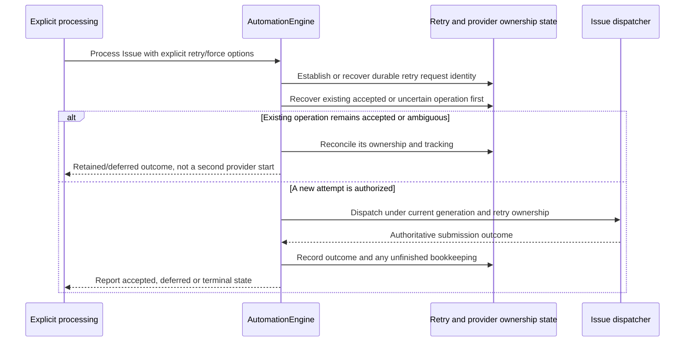
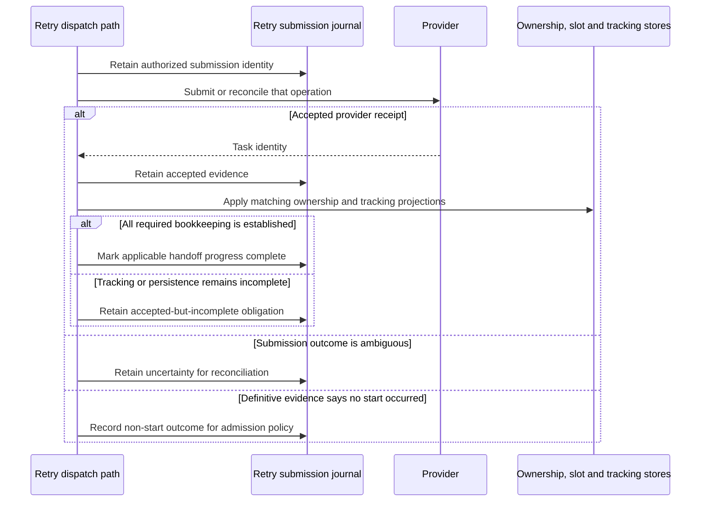

# Issue retry and uncertain-operation recovery

Source snapshot: **`0769b84eaabcf2d0c6a80f6c62660bd179003e02`** (2026-10-18 UTC). [Scope and notation](README.md).

## T1. Explicit retry is not an unconditional fresh submission

`--force` or an explicit retry request must not be diagrammed as bypassing all ownership checks. A durable retry request, the implementation attempt and the provider task binding are different records.

## T2. Acceptance and bookkeeping can finish in different passes

This is a logical sequence, not a claim that all stores commit atomically. Ordinary provider dispatch has provider-specific ordering; do not apply this retry-journal sequence to every Jules/Claude start. See [provider dispatch](issue-provider-dispatch.md).

## T3. Local recovery depends on the entry checkpoint

A proven-dead runner before provider entry can be recovered for entry. After positive provider entry, loss of the runner is not evidence that inference never started. Once a result is recorded, publication recovery resumes downstream effects without running the model again. Unknown liveness retains ownership rather than freeing capacity speculatively.

For remote work, a temporarily missing task/PR observation is not automatically proof that no accepted operation exists. Existing bindings and uncertain receipts must be reconciled before a replacement start. This document does not assert one universal timeout or recovery algorithm across providers.

### Refactoring-sensitive observations

Preserve the original request/attempt/task identity across a lost response. Preserve the difference between accepted-but-untracked and definitely-not-started. Do not release a lifetime slot merely because the current CLI invocation reports Deferred. These distinctions should be characterized at the real recovery origin, not only through a helper returning a chosen Boolean.

Sources: [explicit processing and accepted retry recovery][engine]; [submission/coordinator outcomes][dispatch]; [local job recovery][runner]; [publication replay][finalizer].

[engine]: https://github.com/kitamura-tetsuo/auto-coder/blob/0769b84eaabcf2d0c6a80f6c62660bd179003e02/src/auto_coder/automation_engine.py
[dispatch]: https://github.com/kitamura-tetsuo/auto-coder/blob/0769b84eaabcf2d0c6a80f6c62660bd179003e02/src/auto_coder/issue_dispatch.py
[runner]: https://github.com/kitamura-tetsuo/auto-coder/blob/0769b84eaabcf2d0c6a80f6c62660bd179003e02/src/auto_coder/local_job_runner.py
[finalizer]: https://github.com/kitamura-tetsuo/auto-coder/blob/0769b84eaabcf2d0c6a80f6c62660bd179003e02/src/auto_coder/issue_job_finalizer.py
