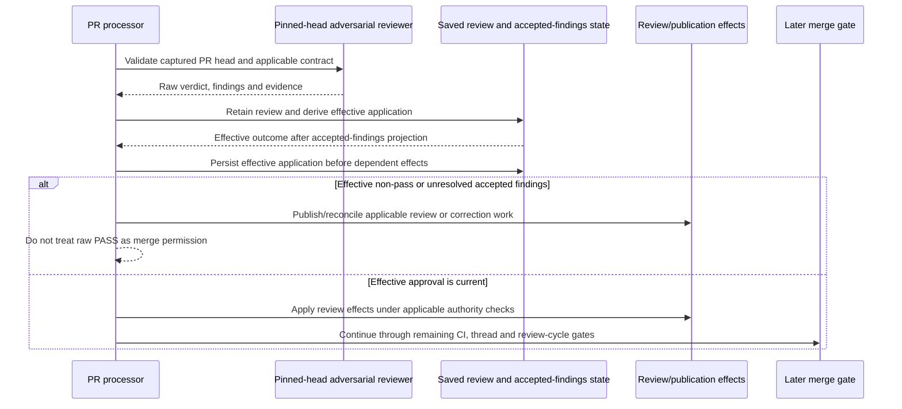
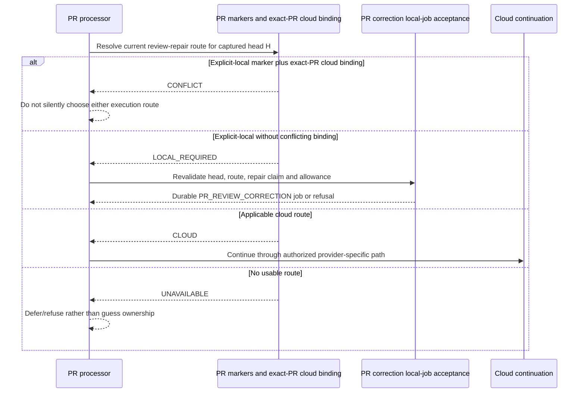
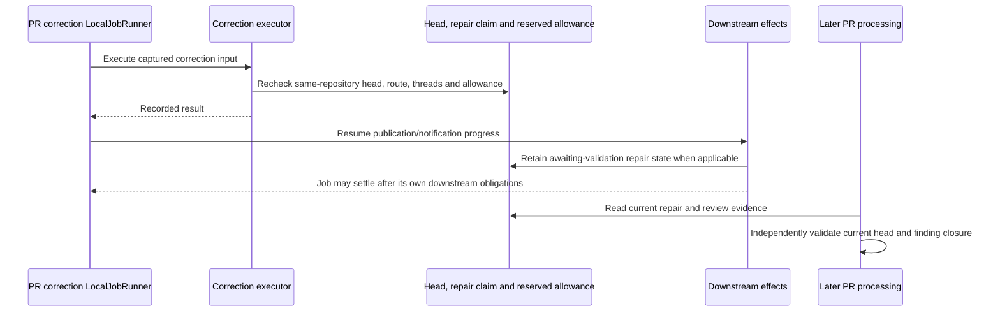

# PR adversarial validation and correction

Source snapshot: **`e1da0e87eb7215d870cbaddd4737bcd9bd6a87e8`** (2026-10-15 JST). [Scope and notation](README.md).

## R1. Raw reviewer output is not the final approval authority

Current-head/current-attempt evidence matters. A saved raw review is reusable only under its applicable identity rules; the highest applicable native attempt is not interchangeable with a legacy fallback. An `ADDRESSED` reply is not independent closure evidence. `_derive_effective_application` and saved non-pass replay preserve the distinction between a model claim and accepted-findings authority.

## R2. Explicit-local review repair can conflict with cloud ownership

The explicit markers include `<!-- auto-coder:local-llm -->` and `<!-- auto-coder:local -->`. A source Issue's cloud history alone is not an exact-PR binding. This routing classification is for review correction; it must not be copied as a description of every CI or conflict branch.

## R3. Local correction completion returns to independent validation

A settled correction job is not an approval. A published repair head can still have failed CI or unresolved accepted findings. Publication replay and validation must not cause inference to rerun merely because an earlier notification was incomplete.

Sources: [review orchestration and routing][pr] (`_derive_effective_application`, `_replay_saved_nonpass_review`, `_preflight_accepted_findings_merge_authority`); [correction executor/finalization][correction]; [durable job state][jobs].

[pr]: https://github.com/kitamura-tetsuo/auto-coder/blob/e1da0e87eb7215d870cbaddd4737bcd9bd6a87e8/src/auto_coder/pr_processor.py
[correction]: https://github.com/kitamura-tetsuo/auto-coder/blob/e1da0e87eb7215d870cbaddd4737bcd9bd6a87e8/src/auto_coder/pr_correction_job.py
[jobs]: https://github.com/kitamura-tetsuo/auto-coder/blob/e1da0e87eb7215d870cbaddd4737bcd9bd6a87e8/src/auto_coder/local_job_handoff.py

## R4. Extracted review coordinator preserves effect authority

`_handle_pr_merge` selects the green-CI review route and delegates its ordinary
and two-tier composition to `_coordinate_pr_review`. The typed coordinator
result reports what the invocation accomplished; it is not merge authority.
The caller-owned `PRReviewRuntime` retains admission and attempt-transition
contexts across the coordinator's final remote-head, CI, thread, current-attempt,
and two-tier checks and through the merge effect. Existing durable review-cycle,
effective-decision, correction-routing, publication, and merge helpers remain
the authoritative producers and consumers.
