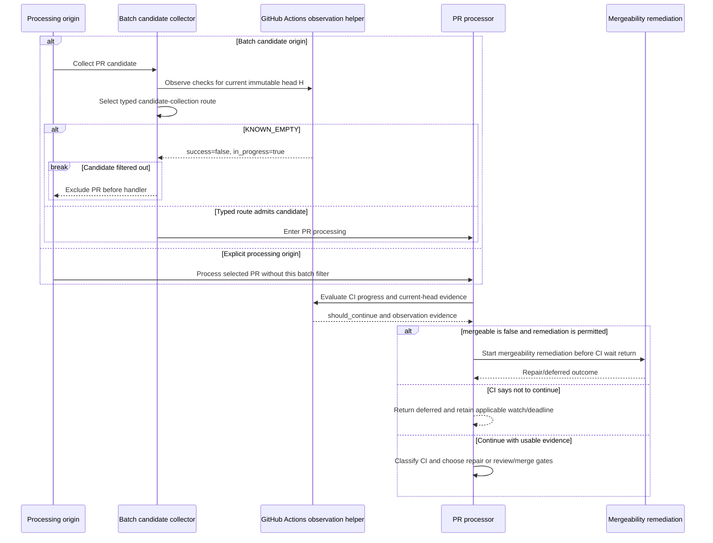
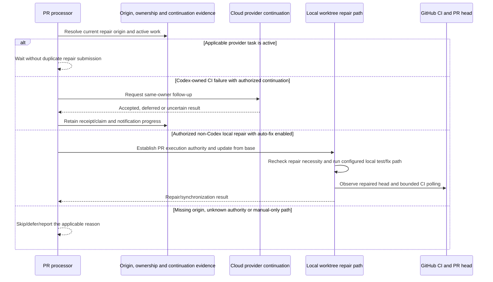

# PR CI observation, reachability and repair

Source snapshot: **`0769b84eaabcf2d0c6a80f6c62660bd179003e02`** (2026-10-18 UTC). [Scope and notation](README.md).

## C1. Candidate filtering and handler ordering are not the same gate

Pre-review selection is now centralized in `pr_progress_policy`. The typed
input includes repository, PR, immutable head and the caller phase; the typed
result identifies the next existing executor and its reason. Evidence remains
produced by the GitHub CI observer, and dispatch, remediation, review and merge
remain separate effect owners. Consequently a selected route is not a claim,
successful execution, review result or merge authorization.

`KNOWN_EMPTY` remains non-passing evidence. Candidate collection admits it only
for an affirmative conflict with enabled remediation; handler evaluation then
selects remediation before waiting. Other known-empty candidates retain the
collector exclusion, while direct handler entry retains the existing CI wait
and durable recheck. Unknown/incomplete observations and stale-head evidence are
never conflated with a clean current run.

The collector passes its single immutable observation through the existing
deployment-approval effect boundary before consuming the policy route. It does
not reinterpret the helper's legacy continue/stop Boolean, and it does not
promote candidate membership into handler or merge authority. Candidate
priority and all non-CI admission/effect owners remain outside the pure policy.
For diagnostics, `KNOWN_EMPTY` is described as absent observations before the
collector reports exclusion or retention; only genuine pending evidence is
described as CI still in progress. The handler uses the same distinction while
retaining the existing durable recheck for both wait routes.

## C2. Workflow dispatch has its own effect boundary

The PR processor contains no-run/workflow-dispatch handling with durable claims keyed to the relevant repository/PR/head/workflow identity. A dispatch request being accepted, rejected or ambiguous is separate from the resulting workflow being observable and complete. A prior uncertain request is not permission to dispatch repeatedly.

Reachability matters: the current `KNOWN_EMPTY` conversion can stop execution before a later no-run branch. The existence of that branch does not establish a universal escape from an empty CI snapshot.

## C3. CI and conflict repair are not generic local jobs

Local CI repair can use local test results and Actions failure information; a passed local test is not proof that GitHub CI passed. `_fix_pr_ci_with_local_llm` remains a synchronous repair path with bounded CI polling. Conflict remediation and `_update_with_base_branch` also have their own result semantics. `success`, `attempt_started`, `should_continue` and synchronization results must not be collapsed into one generic completion flag.

The existing CI-failure and conflict owners are now entered through
`pr_repair_dispatch` requests and return typed dispositions. The adapter carries
the immutable PR head and the established cloud/local origin, but deliberately
contains no provider-selection tree. Existing provider helpers, durable
receipts, worktree operations, test runner, and Git helpers remain the effect
owners; diagnostic action strings are not completion evidence.

The durable local-job kinds in this snapshot cover Issue implementation and PR review correction, not all CI/conflict repairs. See [backend routing](backend-routing-matrix.md).

Sources: [CI conversion][ci] (`_check_github_actions_status`); [candidate collection][engine] (`_get_candidates`); [PR branches][pr] (`_handle_pr_merge`, `_start_mergeability_remediation`, `_fix_pr_ci_with_local_llm`, `_update_with_base_branch`); [local-job kinds][jobs].

[ci]: https://github.com/kitamura-tetsuo/auto-coder/blob/0769b84eaabcf2d0c6a80f6c62660bd179003e02/src/auto_coder/util/github_action.py
[engine]: https://github.com/kitamura-tetsuo/auto-coder/blob/0769b84eaabcf2d0c6a80f6c62660bd179003e02/src/auto_coder/automation_engine.py
[pr]: https://github.com/kitamura-tetsuo/auto-coder/blob/0769b84eaabcf2d0c6a80f6c62660bd179003e02/src/auto_coder/pr_processor.py
[jobs]: https://github.com/kitamura-tetsuo/auto-coder/blob/0769b84eaabcf2d0c6a80f6c62660bd179003e02/src/auto_coder/local_job_handoff.py
