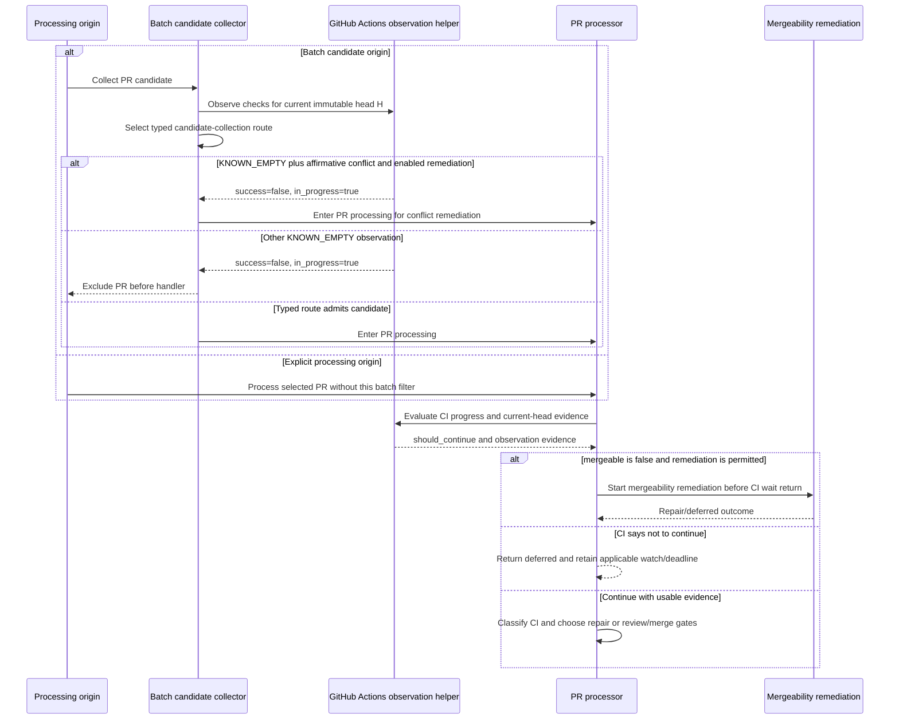
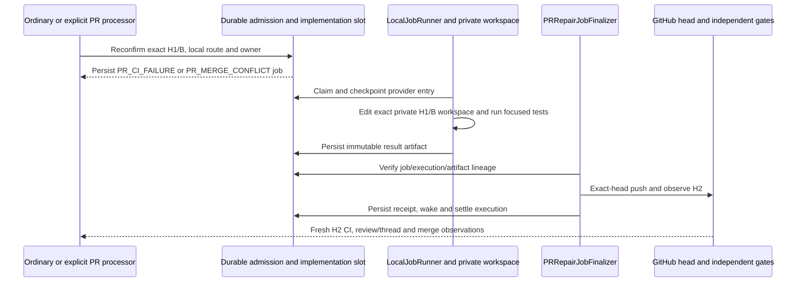

# PR CI observation, reachability and repair

Source snapshot: **`39cc4c0`** (2026-10-22 UTC). [Scope and notation](README.md).

## C1. Candidate filtering and handler ordering are not the same gate

Pre-review selection is now centralized in `pr_progress_policy`. The typed
input includes repository, PR, immutable head and the caller phase; the typed
result identifies the next existing executor and its reason. Evidence remains
produced by the GitHub CI observer, and dispatch, remediation, review and merge
remain separate effect owners. Consequently a selected route is not a claim,
successful execution, review result or merge authorization.

`KNOWN_EMPTY` remains non-passing evidence. Candidate collection admits it only
for an affirmative conflict with enabled remediation; handler evaluation then
selects remediation before waiting. Other known-empty candidates retain the
collector exclusion, while direct handler entry retains the existing CI wait
and durable recheck. Unknown/incomplete observations and stale-head evidence are
never conflated with a clean current run.

The collector passes its single immutable observation through the existing
deployment-approval effect boundary before consuming the policy route. It does
not reinterpret the helper's legacy continue/stop Boolean, and it does not
promote candidate membership into handler or merge authority. Candidate
priority and all non-CI admission/effect owners remain outside the pure policy.
For diagnostics, `KNOWN_EMPTY` is described as absent observations before the
collector reports exclusion or retention; only genuine pending evidence is
described as CI still in progress. The handler uses the same distinction while
retaining the existing durable recheck for both wait routes.

## C2. Workflow dispatch has its own effect boundary

The PR processor contains no-run/workflow-dispatch handling with durable claims keyed to the relevant repository/PR/head/workflow identity. A dispatch request being accepted, rejected or ambiguous is separate from the resulting workflow being observable and complete. A prior uncertain request is not permission to dispatch repeatedly.

Reachability matters: the current `KNOWN_EMPTY` conversion can stop execution before a later no-run branch. The existence of that branch does not establish a universal escape from an empty CI snapshot.

## C3. Eligible local CI and conflict repairs are durable jobs

Both ordinary `_handle_pr_merge` selection and explicit target processing stop
at the same durable offer for eligible local routes. The runner claims that
exact envelope; CI and conflict adapters prepare private workspaces and retain
model output plus witnessed editing identity in the immutable artifact. Cloud
continuations, review correction and base-update routing keep their existing
owners and are not converted by this path.

Provider entry without confirmed continuation support is **unable to resume**
and remains reconciliation-pending; it is never permission for a second model
invocation. A confirmed artifact whose commit, push receipt, or wake is
incomplete is **pending finalization** and can be replayed without model entry.
Only exact remote observation of the candidate establishes **confirmed H2**.
H2 then invalidates older observations: current-head CI, review/thread/two-tier
acceptance, observed merge, and lifetime retirement remain independent facts.

The maintained joined positive group is
`tests/test_durable_local_pr_repair_lifecycle.py`. Focused failure/reentry
coverage remains in `tests/test_z_local_ci_repair_job.py`,
`tests/test_local_conflict_repair_job.py`, and
`tests/test_pr_repair_finalizer.py`; see the [bounded inventory](../../client-features/pr-repair-execution-test-inventory.md).
These controlled GitHub/provider transports are not the unavailable opt-in live
profile. See also [backend routing](backend-routing-matrix.md) and the
[feature lifecycle](../../client-features/durable-local-pr-repair-lifecycle.md).

Sources: [CI conversion][ci] (`_check_github_actions_status`); [candidate collection][engine] (`_get_candidates`); [PR branches][pr] (`_handle_pr_merge`, `_start_mergeability_remediation`, `_fix_pr_issues_with_testing`, `_submit_ci_repair_candidate`, `_update_with_base_branch`); [local CI execution][local-ci] (`execute_local_ci_repair`, `execute_correction`); [local-job kinds][jobs].

[ci]: https://github.com/kitamura-tetsuo/auto-coder/blob/2c5624a/src/auto_coder/util/github_action.py
[engine]: https://github.com/kitamura-tetsuo/auto-coder/blob/2c5624a/src/auto_coder/automation_engine.py
[pr]: https://github.com/kitamura-tetsuo/auto-coder/blob/2c5624a/src/auto_coder/pr_processor.py
[local-ci]: https://github.com/kitamura-tetsuo/auto-coder/blob/2c5624a/src/auto_coder/local_ci_repair_execution.py
[jobs]: https://github.com/kitamura-tetsuo/auto-coder/blob/2c5624a/src/auto_coder/local_job_handoff.py
