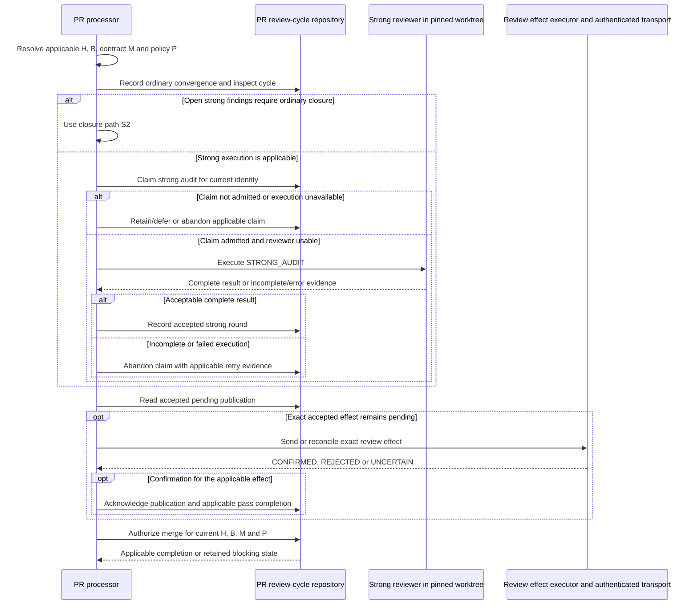
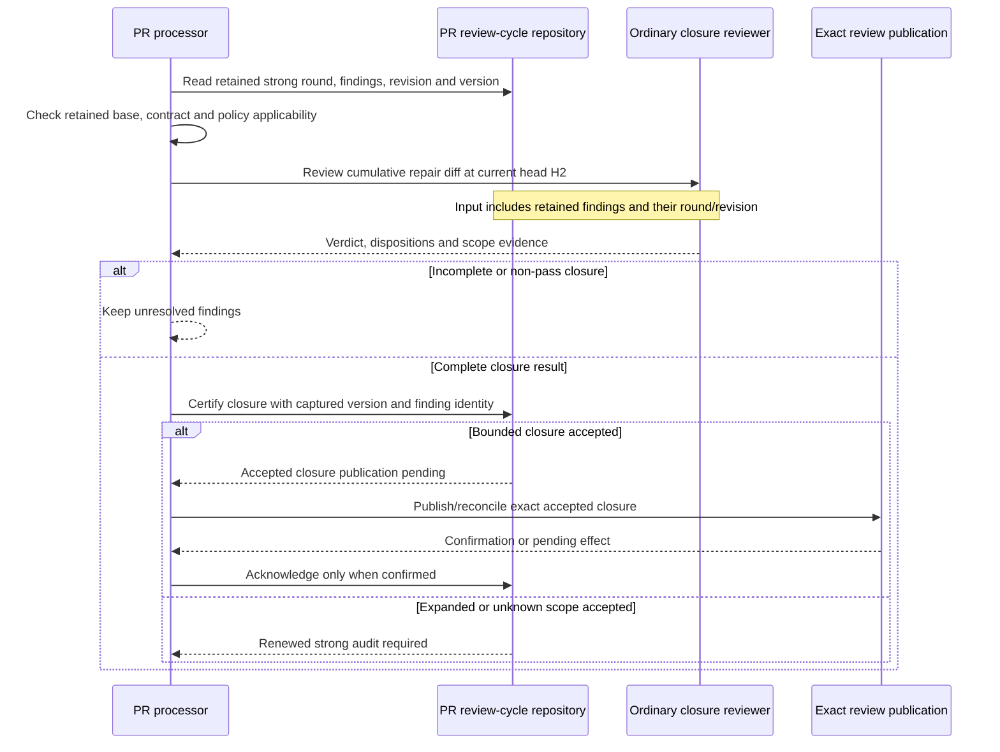

# Two-tier PR review and publication

Source snapshot: **`e1da0e87eb7215d870cbaddd4737bcd9bd6a87e8`** (2026-10-15 JST). [Scope and notation](README.md).

## S1. Strong execution and accepted publication are separate

The optional two-tier gate has its own applicability checks and contract/policy identity. It is not a universal extra review for every PR. Where applicable, the gate uses the PR head/base and collected Issue requirement declarations; its contract identity is not a generic synonym for every Issue parser in the system.

An accepted-but-unpublished result is not permission to launch another strong audit indiscriminately. Conversely, merely calling a helper with "pending" in its name does not prove only one execution ever occurs: durable cycle identity, claim and publication state decide that.

## S2. Ordinary closure must account for retained strong findings

A raw ordinary PASS does not delete strong findings. Pending-publication reconciliation can still occur when this invocation did not run a new reviewer. `STRONG_PENDING` alone is not a receipt: it can cover execution/retry work or accepted evidence awaiting publication.

Daemon processing can persist a targeted review-cycle deadline for reentry. That is not a promise that a one-shot CLI invocation keeps running until the deadline. The final PR merge path still checks current head, CI, unresolved threads, provider continuation and accepted-findings authority independently of this gate.

Sources: [gate inputs, strong audit, closure and publication callers][pr]; [cycle state][cycle]; [merge predicate][gate]; [deadline reentry][engine].

[pr]: https://github.com/kitamura-tetsuo/auto-coder/blob/e1da0e87eb7215d870cbaddd4737bcd9bd6a87e8/src/auto_coder/pr_processor.py
[cycle]: https://github.com/kitamura-tetsuo/auto-coder/blob/e1da0e87eb7215d870cbaddd4737bcd9bd6a87e8/src/auto_coder/pr_review_cycle.py
[gate]: https://github.com/kitamura-tetsuo/auto-coder/blob/e1da0e87eb7215d870cbaddd4737bcd9bd6a87e8/src/auto_coder/two_tier_pr_gate.py
[engine]: https://github.com/kitamura-tetsuo/auto-coder/blob/e1da0e87eb7215d870cbaddd4737bcd9bd6a87e8/src/auto_coder/automation_engine.py
